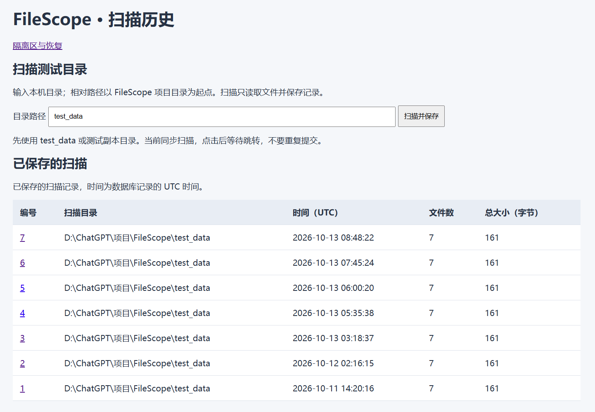
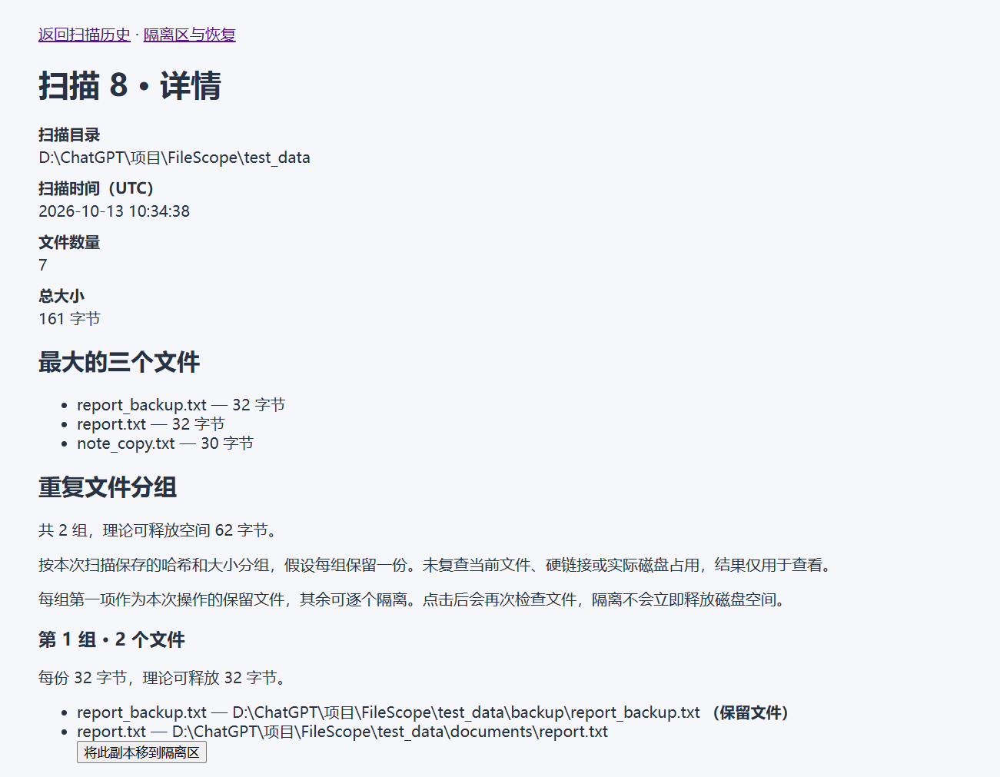
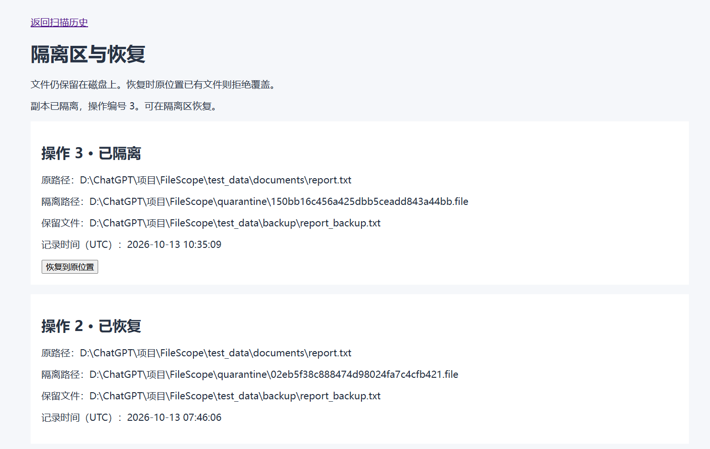
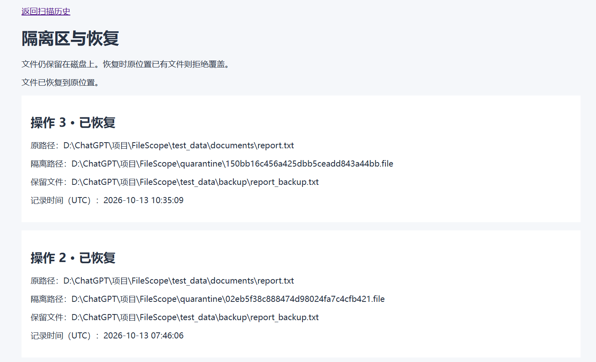

# FileScope

FileScope 是一个本地文件扫描、重复文件检测与存储分析平台。

技术栈：Python、SQLite、Flask、Jinja、HTML/CSS、pytest。当前是本机学习与演示项目，不是生产部署版本。

## 新下载项目的快速开始

先打开终端进入下载后的 FileScope 文件夹。以下命令适用于 Windows CMD（本次验证使用 Python 3.14）：

```cmd
python -m venv .venv
.venv\Scripts\activate
python -m pip install -r requirements.txt
python app.py
```

浏览器打开 http://127.0.0.1:5000/history，输入 `test_data` 发起扫描。数据库由程序自动初始化，不需要下载作者本机的数据库。Linux 步骤见 [运行验证说明](docs/linux-validation.md)。

## 演示与设计来源

- [五分钟演示与个人参与记录](docs/demo-and-learning.md)
- [经典项目借鉴说明](docs/references.md)
- [截图保存与发布前检查](docs/share-checklist.md)

第一版演示已验证扫描、详情报告、单文件隔离和恢复。隔离不释放空间；理论可释放空间不等于实际磁盘占用。

### 页面截图

以下为测试数据的真实运行截图。示例中有 7 个文件、2 个重复组，理论可释放空间为 62 字节；隔离后仍保留磁盘文件。

扫描历史与扫描入口：



详情、最大文件与重复报告：



[查看完整文件列表截图](docs/images/文件列表.png)。大小相同的 `same_size_a.txt` 和 `same_size_b.txt` 内容不同，不被判定为重复；`unique.txt` 大小唯一，无需计算哈希。

隔离副本（操作 3）：



恢复同一副本：



## 第一版目标

- 扫描指定目录
- 读取文件路径、大小、扩展名和修改时间
- 检测内容完全相同的文件
- 生成重复文件报告
- 扫描不修改文件；主动选择后可隔离和恢复副本

## 安全原则

扫描只读。隔离与恢复仅在用户主动提交后执行，不提供永久删除。

所有开发和测试只使用 test_data，不使用真实重要文件。

## 本地网页运行

在项目根目录的 CMD 中：

```cmd
cd /d "D:\ChatGPT\项目\FileScope"
.venv\Scripts\activate
python -m pip install -r requirements.txt
python app.py
```

浏览器打开 http://127.0.0.1:5000/history，输入 `test_data`，点击“扫描并保存”。
扫描成功后自动打开本次详情，历史列表中新增记录。相对路径以项目根目录为起点。
当前同步执行扫描，等待完成后再进行下一次提交。Ctrl+C 停止服务；修改代码后需保存并重启。

如果是新下载的项目，还没有虚拟环境，先在项目根目录运行 `python -m venv .venv`，再执行上面的激活和安装步骤。已有虚拟环境不必重建。

## 命令行与测试

在已激活虚拟环境的项目根目录运行：

```cmd
python src\filescope.py test_data
python src\filescope.py history
python src\filescope.py show 2
python -m pip install -r requirements-dev.txt
python -m pytest -q
```

前三条分别是扫描并保存、查询历史、查看编号为 2 的扫描；编号需要替换成自己的已有记录。扫描命令会新增数据库记录，历史查询不会重新扫描文件。后两条用于安装测试依赖并执行自动化测试。

网页入口：`/history` 查看历史与提交扫描，`/scan/<编号>` 查看详情，`/quarantine` 查看隔离与恢复，`/api/status` 返回状态 JSON。网址在浏览器打开，不接在 `python app.py` 后面。

## 项目框架

受控性能验证见 [实验计划](docs/benchmark-plan.md) 和 [Windows 实测报告](docs/experiments/size-filter-20261013T112723855156Z.md)。报告包含原始数据链接与测量限制，不代表生产性能。

展示项目与复盘个人参与情况见 [演示与学习记录](docs/demo-and-learning.md)。

Linux 环境的启动步骤、验证结果与跨系统路径限制见 [WSL Ubuntu 运行与验证](docs/linux-validation.md)。

完整的模块职责与数据流见 [项目框架说明](docs/architecture.md)。网页使用 Flask + Jinja 服务端模板，暂不引入独立前端框架、后台任务队列或永久删除功能。

## 代码调用关系

```text
CLI / Flask路由
    → services.scan_and_save（目录校验、组织扫描保存）
    → filescope.scan_directory（文件扫描与哈希）
    → database.save_scan_results（SQLite事务保存）
    → 扫描编号返回入口
    → reports / HTML模板（展示结果）
```

参考 dupeGuru 的核心与展示分离思路，逐步把已有逻辑接入服务层。
保留现有按大小筛选及SHA-256，已参考 fdupes 的检测流程独立实现分块内容确认、硬链接身份去重、读取前后属性检查。参考源码入口为 `confirmmatch.c` 和 `fdupes.c`，版本与对照见项目外的 `FileScope-开源项目对照.md`。
SQLite历史、统计、Flask网页与隔离恢复为本项目扩展。历史报告基于扫描快照，文件操作前重新检查内容和属性。

## 单文件隔离与恢复

详情页每组第一项是保留文件，其余副本可逐个点击隔离。服务端重新检查扫描记录、大小、修改时间、哈希和实际内容，拒绝操作保留文件、变化文件或硬链接别名。

副本放在项目 `quarantine/` 中，以随机名称保存；`quarantine_records` 记录原位置、隔离位置、保留对象、时间和操作状态。扫描排除隔离区；历史快照仍保留原扫描成员。

进入“隔离区与恢复”可恢复到原路径，原位置有同名文件或链接时拒绝覆盖。当前只支持同一文件系统且支持硬链接的普通文件：先建立目标链接，再解除源路径；跨文件系统或不支持链接时失败并保留源文件。隔离本身不释放磁盘空间。

文件操作与数据库不天然原子化：先提交 pending 意图，再移动并更新状态；后续失败时尝试补偿移动。异常退出或补偿失败可留下“待核对”记录，两条路径仍在数据库中，需核对后恢复。原文件和隔离文件都存在时不会自动覆盖或删除其中任何一个。

服务限本机学习使用。操作表单带会话令牌，重启服务后先刷新页面获取新令牌。属性与内容检查不等于锁住其他程序对文件的修改，文件操作过程中仍应避免外部编辑。

## 新扫描的判定规则

- 普通文件按设备号和文件编号去重，硬链接别名只保留首次遇到的路径；文件数量和总大小统计排除其余别名。
- 默认跳过文件符号链接，不递归目录符号链接；空文件参与重复检测，但可释放空间为零。
- 大小相同才计算哈希；哈希相同再逐块比较内容。
- 文件消失、读取失败、属性变化或内容确认失败时，不把相关候选组作为重复结果；无法确认的记录将哈希置空，防止数据库查询重新误分组。
- 属性检查是扫描期间的变化检测，不是文件锁。扫描结束后文件仍可能变化，未来隔离操作前必须重新验证。

已有扫描历史不改写。要使用新规则，需要重新扫描；总大小与可释放空间仍是按内容字节数估算，不等于实际磁盘块占用。
